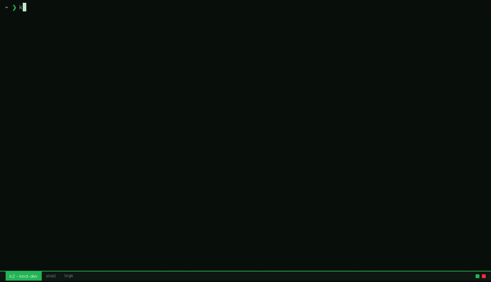
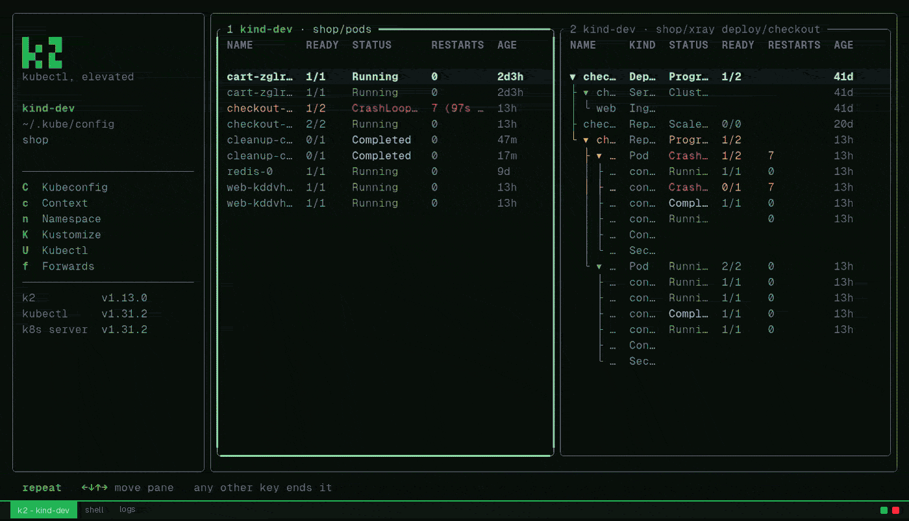
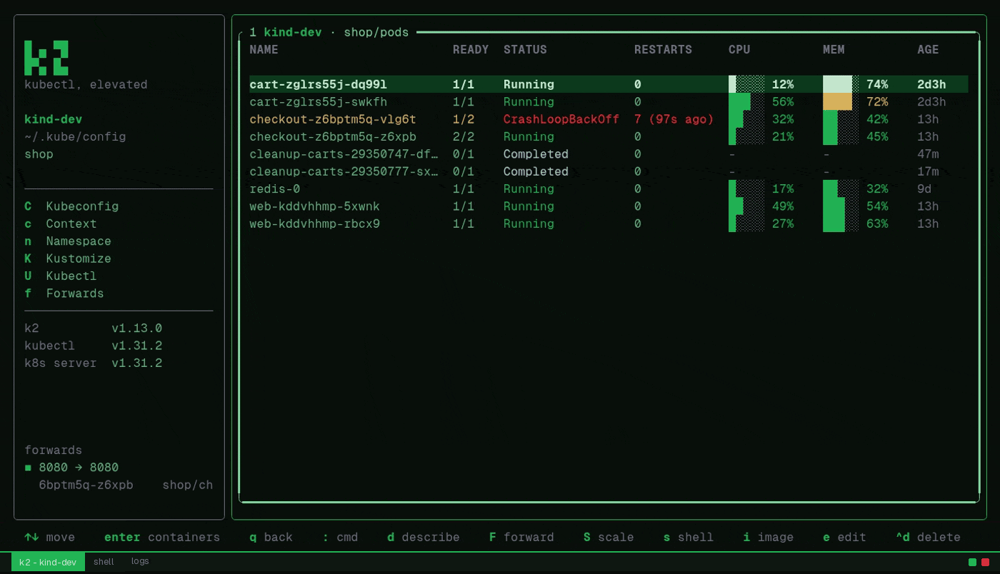

<div align="center">

<h1></h1>

**kubectl, elevated.** A terminal UI for working with several Kubernetes clusters side by side.

[](LICENSE)
[](go.mod)

</div>

k2 puts clusters in tmux-style panes and tabs. Each pane has its own
kubeconfig, context and namespace, so kind, staging and OpenShift can sit
on one screen.

- Pane and tab keys work like tmux, behind a `ctrl+a` prefix.
- vim, shells and cluster edits run *inside* a pane; the others keep going.
- k2 just runs `kubectl`, so anything the cluster serves works: built-in
  kinds, CRDs, OLM, OpenShift Routes and Projects.
- When you quit, your shell lands on the focused pane's cluster and namespace.

Inspired by [k9s](https://k9scli.io/)
([github.com/derailed/k9s](https://github.com/derailed/k9s)). A lot of the
same ideas will feel familiar: `:` commands, short names (`:sts`, `:svc`),
xray, `0` for all namespaces, `i` to set an image. k2 adds splits, sessions
that come back, and a few workflows of its own.


## Install

Linux, with `kubectl` on `PATH`.

**Install script (linux/amd64).** Downloads the newest `.deb` or `.rpm` from
the releases page and installs it. Run it again to update; it no-ops if you
already have the latest. `K2_VERSION=<tag>` pins a release.

```zsh
curl -fsSL https://raw.githubusercontent.com/wkonsek/k2/main/install.sh | bash
```

**Update from k2.** `k2 --update` (or `k2 -U`) runs that same script, so a
`sudo` prompt works. Needs `bash` and `curl` or `wget`. It never starts the
UI. `K2_VERSION=<tag> k2 --update` picks a release.

**From a package (linux/amd64).** Grab one from the
[releases page](https://github.com/wkonsek/k2/releases), or `make rpm` /
`make deb` (`make dist` for both; files land in `dist/`):

```zsh
sudo dnf install ./k2-<version>-1.x86_64.rpm      # Fedora
sudo apt install ./k2_<version>_amd64.deb         # Ubuntu / Debian
```

Packages put `k2` in `/usr/bin`, the example config in
`/usr/share/k2/config.example.yaml`, and the README, cheatsheet, LICENSE
and NOTICE in `/usr/share/doc/k2/`. kubectl is recommended, not required.

Building the packages needs `rpmbuild` (`dnf install rpm-build` or `apt
install rpm`) and `dpkg-deb` (`apt install dpkg-dev` or `dnf install dpkg`).

**From source** (Go 1.24 or newer):

```zsh
git clone https://github.com/wkonsek/k2.git && cd k2
make install    # $(go env GOPATH)/bin/k2  (or: go install ./cmd/k2)
make build      # bin/k2 only
```

**Shell function.** On exit k2 prints `export KUBECONFIG="..."` for the
focused pane. Drop this in `~/.zshrc` (bash is the same):

```zsh
k2() {
  if (( $# )); then
    command k2 "$@"
    return
  fi
  local out
  out="$(command k2)" || return
  if [[ $out == 'export KUBECONFIG='* && $out != *$'\n'* ]]; then
    eval "$out"
  fi
}
```

It only evaluates a clean exit: one `export KUBECONFIG=...` line, exit 0.
With arguments (`k2 --version`, `k2 --help`, `k2 --init-config`,
`k2 --update`, `k2 kind-cache clean …`) k2 runs as-is. A crash restores the terminal, writes the
stack to `~/.k2/crash.log` and prints one line to stderr.

## Quick start

```zsh
k2
```

First start writes a commented config to `~/.k2/config.yaml`. Then:

| Key | |
|---|---|
| `c` / `C` / `n` | context / kubeconfig / namespace |
| `:` | command line: `:pods`, `:deploy`, `:helm`, `:xray deploy`, `:logs app=web`, `:pulse` … (`tab` completes) |
| `enter`, `d`, `e` | open (logs of a one-container pod, containers of a pod, YAML of most objects), describe, edit |
| `ctrl+f`, `F`, `f` | port-forward the selected row (`F` on a pod too), list forwards |
| `ctrl+t` | theme for this context (saved to the config) |
| `K`, `U` | Kustomize browser, kubectl view |
| `.` | in the Kustomize browser: open the folder in VS Code (`code <dir>`) |
| `ctrl+a %`, `ctrl+a "` | split right, split down |
| `ctrl+a c`, `ctrl+a n` | new tab, next tab |
| `ctrl+arrows` | move between panes |
| `0` | all namespaces and back |
| `q` / `esc` | back (previous `:` view or drill, or home); with rows selected, clear the selection first |
| `~` | kind clusters (`:kind`); `q` goes back to where you were |
| `?` | help for the current view |
| `Q` | quit; your shell switches to the focused pane's cluster |
| `space` | select rows; `ctrl+d` deletes them, `M` tails those pods; `q` / `esc` clears the selection (press again to go back) |
| `ctrl+p` | save this layout as a profile (`:profile save dev`, `k2 --profile dev`) |
| `:fresh` | close every tab and pane, leave one home pane (`k2 --fresh` does it at start) |

Every key is in the **[keyboard cheatsheet](CHEATSHEET.md)**.

## Highlights

**Sessions that survive a restart.** Quit and start again; it comes back:

- tabs (with names) and split layouts
- each pane's kubeconfig, context and namespace
- the list or logs each pane showed, including a stern view
- favorites, favorite commands and the last Kustomize directory

Port-forwards are detached `kubectl` processes. They keep running after k2
exits. Next start, k2 picks up the live ones and restarts the ones that
died (when auto-restart says so).


**Splits, tabs and vim in a pane.** Same keys as tmux:

- `ctrl+a %` splits right, `ctrl+a "` splits down
- `ctrl+a c` opens a tab, `ctrl+a z` zooms
- `e` (edit the object), `v` (any text) and `s` (a shell in the pod) open
  inside the pane; every pane can run its own editor



**Self-healing port-forwards.** `ctrl+f` on a pod, service, deployment or
statefulset suggests ports from the spec.

- k2 watches kubectl's output and the forwarded pods, so a rolling restart
  that ate the pod is marked dead, with the reason
- `r` restarts it through its owner
  (`pod gone → forwarding via deploy/kafka-connect`)
- `portforward.auto_restart` does that on its own, including next start

Without that setting, and without `a` on the forward itself, a dead forward
stays dead across restarts.


**Kustomize browser.** `K` browses directories, marks kustomizations with a
green square, and diffs, applies or deletes them.

- A plain YAML file has no square; `A` applies it, `D` diffs it and
  `ctrl+d` deletes it, all with `kubectl -f`.
- Apply and delete show a progress bar over the objects the kustomization
  renders to.
- Output shows up as kubectl prints it, with an icon and a color
  (`+` created, `~` configured, `−` deleted, `✗` error). A bordered
  summary closes the run.
- Diffs get one bold header per resource. From the diff, `A` asks, then
  applies the same kustomization and shows the apply progress in place.
- If a diff or apply fails because a namespace is missing, k2 asks to
  create it (`y`) and re-runs. Read-only mode (`R`) just leaves the error.


**Owner tree (`:xray`).** `X` on a row or `:xray deploy web` shows a
workload and everything it owns: Deployment → ReplicaSets → Pods →
containers, plus services, ingresses, config maps, secrets and PVCs.
Status colors, READY, RESTARTS. A namespace-wide tree starts folded, with
a one-line summary per root; roots in trouble start open.


**Multi-pod logs.** `M` on a workload, service or pod follows all its pods,
stern-style. Lines are prefixed with a colored `pod/container`.
`:logs app=web --since=10m -c app` takes a label selector or a pod-name
pattern (not `kind name`). New pods show up as they appear. `m` draws a
rule after the current line.


**Helm releases.** `:helm` lists releases, decoded from Helm's secrets (no
helm CLI needed to browse). Values, computed values, manifest, notes,
revision history. Mark two revisions and diff them per resource. Install,
upgrade or roll back uses the helm CLI, when it's installed.

**Kind clusters.** `:kind` (or `~`) shows local kind clusters as full-width stacked
cards, with square status, uptime, CPU and RAM bars, and installed catalog
charts wrapped across lines. `A` (or `:kind create`) opens a form: name,
control-planes, workers, a config path (prefilled with the generated Kind
YAML, which stays in sync with the form; `ctrl+e` opens it in `$EDITOR`
and those edits flow back into the form, or type your own path), plus a node
image picker (the five latest stable `kindest/node` tags, `tab` /
`shift+tab` cycle them) and checkboxes for starter charts. `v` on a chart
edits its values in `$EDITOR`. On `sealed-secrets`, `m` picks a master-key YAML (default `helm.charts.sealed-secrets.master_key_path`) that k2 applies before installing the operator. A
red popup confirms (`esc`/`q` returns to the form, `n` cancels), then a `deploying` tile appears immediately and k2
streams `kind create cluster` into a live log (`enter` to watch, `esc`
back to the tiles). The kubeconfig is written to `~/.kube/k2` (or
`~/.kube/k2-<name>`). `space` on a ready card uses that cluster in the
pane; `enter` opens live control-plane logs. `e` manages catalog charts. `ctrl+d` deletes the cluster and only
that k2 kubeconfig file, never `~/.kube/config`. If that cluster was the
active one and exactly one other kind cluster still has a kubeconfig, the
pane switches to it. After MetalLB lands on a kind cluster, k2 picks an
address pool from the kind Docker network.


**Safe on production.** List production contexts under `prod:`:

- those panes get a red border and ☠
- every destructive action asks in a red popup that names the target and
  context
- `enter` never confirms; only `y` does

An entry is an exact name, a glob (`"*prod*"`, `"prod-*"`, `?` for one
character; `*` also matches `/` and `:` in names like
`arn:aws:eks:…:cluster/prod-x`) or a regex, `"re:^prod-(eu|us)-"`. Quote
globs; YAML reads a bare `*` as an alias. A broken regex is reported and
skipped.

Separately, `ui.context_themes` gives a context its own theme. The UI
re-colors live as you move between panes.


**Token lifetime.** For OpenShift `oc login` tokens and JWTs, the sidebar
shows how long the focused context's token is still valid. The bar shrinks
live and turns yellow, then red, before it expires.


**And the small things.**

- `:pulse` is a namespace's health on one screen.
- `b` pins favorite context + namespace (+ view) targets; `1`-`9` jumps.
- `0` toggles all namespaces on every list.
- Pod lists have live CPU and MEM bars against limits.
- `i` sets images, `S` scales, `r` restarts a rollout.
- OLM Subscriptions, CSVs and InstallPlans have their own views.
- `R` makes the session read-only; mutating keys are ignored.


**Favorite commands.** Type a command with `:`, then `ctrl+s` to keep it.
`B` opens the list as a popup, `:cmds` as a view. Clone with `c`, then
edit or rename. Built-in commands live in a shared profile; yours stay in
your config.


**Containers, then back.** `enter` on a pod with one container opens its
logs; with several, the containers list: image, ports, probes, restarts,
CPU and memory. `l` still opens logs from that list (or a picker). Jumps
like `:secrets` and `:pods` open the full list, not a drilled-down view,
and remember where you were, so `q` walks back through them (`:helm` and
`~` too).


**Logs that stay still when you say so.** Followed logs stream live. Leave
the viewport or start a search and the stream keeps running underneath.
The header shows `paused +N new`. `end` or `G` catches you up. `1` and
`2` dump the last 30 or 60 minutes into less.

## Reference

The full key list, with the config name of each key, is in
[CHEATSHEET.md](CHEATSHEET.md).

### Prefix, panes and tabs

Pane and tab keys come after `ctrl+a` (`keys.prefix`): press it, let go,
press one key. The status line shows `prefix ctrl+a …` and the legend
lists the keys while k2 waits (1.5 s, `esc` cancels).

The prefix works in tables, viewers and the in-pane vim / shell;
`ctrl+a ctrl+a` sends a literal `ctrl+a` there. In k2's own text inputs
(`:` line, `/` filter, kubectl line, path field, popups) `ctrl+a` stays
the editing key (line start): press `esc` first, or use `ctrl+arrows`.
`keys.prefix` takes any ctrl+, alt+ or function key, e.g. `ctrl+\`, which
also works in inputs.

After the prefix, `" % c & , n p o ; z x`, the arrows and `1`-`9` mean
what they mean in tmux. k2 also has `h` (split down), `v` (split right),
`t` (new tab) and `w` (close tab).

- Splits nest up to 4 panes per tab (`max_panes`).
- `ctrl+arrows` or the prefix plus arrows move to the nearest pane; more
  arrows within 1 s keep moving.
- `ctrl+a o` cycles panes, `ctrl+a ;` jumps back, `ctrl+a z` or `Z` zooms.
- `]` / `[` switch tabs on their own (inside inputs and vim use
  `ctrl+a n` / `ctrl+a p`).
- `ctrl+a ,` renames a tab (empty restores the automatic name).
- `ctrl+a x` and `ctrl+a &` ask before closing a pane or a tab, in red
  when vim or a shell runs there.
- `ctrl+d` on the home screen closes a pane without asking; the last pane
  closes the tab, and the only tab quits, like `Q`. Off home, `ctrl+d`
  still deletes and still asks.
- The tab bar appears from two tabs on (`ui.tabbar`) and marks a tab with
  a production pane in red with ☠.

### Sidebar and the command line

The sidebar never takes focus. It shows the focused pane's target,
cluster info, token lifetime and forwards. Entries open in the focused
pane with `C` `c` `n` `K` `U` `f`, or `:kubeconfig` (`:kc`), `:context`
(`:ctx`), `:namespace` (`:ns`), `:kustomize` (`:k`), `:kubectl`,
`:forwards` (`:pf`, `:fwd`). On OpenShift the namespace picker lists
projects. Picking a namespace from a pod or resource list returns to that
list.

**`:` line.** Any resource name the cluster reports works
(`:deployments`, `:subscriptions`, `:routes` …), plus your `aliases:` and
built-in short names (`:deploy`, `:sts`, `:ds`, `:cj`, `:ev`, `:csr`, `:sub`,
`:csv`, `:rt` …) unless your config or the cluster gives a name another
meaning. `:csr` is cert-manager CertificateRequests; type
`:certificatesigningrequests` for the Kubernetes ones. `:certs` shows the
issuer next to READY and SECRET.

Custom resources work by plural, singular or short name, or with the
group spelled out: `:gateways.networking.istio.io` or
`:gateway.networking.k8s.io/v1/gatewayclasses`. When several API groups
serve the same name (`:gateways` from Gateway API and Istio), k2 asks the
upstream `*.k8s.io` group first, falls back to the one that has objects,
and names the others in the status line. Gateway API gateways, gateway
classes and HTTP routes, and Istio gateways and virtual services get
their own columns; other custom resources show NAME and AGE.

`tab` completes targets, resources, aliases, and for `:xray`,
`:logs` / `:stern` and `:fav` the kinds and names from the cluster.
Resources are also offered as `name.group` and `group/version/name`; the
first match shows dimmed after the cursor and `right` takes it. A kind
the cluster does not serve says `… is not installed on this cluster (no
OLM)` or `(not OpenShift)`.

### Tables, pods, workloads

Every table live-refreshes, with a counting AGE column. `/` filters;
`>` / `<` sort by the next / previous column, `=` flips the direction.
`0` toggles all namespaces (the selected object stays selected;
remembered per pane). `pgdown` / `}` and `pgup` / `{` page. `w` / `W`
copy the name / `kind/name -n ns` (legend `copy name`). `L` / `A` label /
annotate, `d` describes (warning events colored), `e` edits, `ctrl+d`
deletes, `enter` shows the YAML (on a pod: its containers).

STATUS is colored by meaning; names turn the warning color only for real
trouble (not ready, Pending, CrashLoopBackOff, Terminating …). RESTARTS
reads `3 (5m ago)` and is red when the last restart was under an hour
ago. Empty lists say where to look: `no pods in shop — press 0 for all
namespaces`.

**Pods.** `enter` opens the containers, as k9s does: init containers and
sidecars included, with state, restarts, probes, CPU and MEM (`kubectl
top pod --containers`), requests and limits, usage percentages, ports and
age. From there, `enter` or `l` follows that container's logs, `p` its
previous logs, `s` opens a shell in it, `F` forwards one of its ports,
`d` describes the pod, `esc` returns to the pods with the same pod
selected.

`l` on the pods list follows the pod (`kubectl logs -f`, `logs.tail`
lines to start with). A busy container loses no lines; the stream
reconnects when it ends and stops when you leave. `p` switches to the
previous container, `m` draws a separator, `1` and `2` open the last 30
and 60 minutes in `less` with no line cap (not in stern). `s` opens a
shell in the pane (bash, else sh). `F` port-forwards (`ctrl+f` still
works). `S` scales the deployment or statefulset that owns the pod. On
the pods list, `l` and `p` ask which container when a pod has several.

CPU and MEM come from `kubectl top pods` every `ui.metrics_every` seconds
(15) and show `45m ███░░ 62%`: usage against the summed limits, or the
requests (`~62%`) when not every container has a limit. Yellow from
`ui.metrics_warn` (70), red from `ui.metrics_crit` (90). Without
metrics-server they show `N/A` and the list keeps working.

`:nodes` shows NAME, STATUS, ROLES, AGE and VERSION like `kubectl get
nodes`, plus CPU and MEM from `kubectl top nodes` against the
allocatable. Without metrics-server those two columns are left out.

**Workloads.** `S` scales (on a pod, the deployment or statefulset that
owns it). `r` runs `kubectl rollout restart`. `i` sets images: a popup
lists every container and init container; only the changed ones are sent,
after a confirmation showing `old → new`. Jobs show status, completions
and duration (`enter` lists their pods). Cronjobs show the schedule and
last run; `t` runs one now. `:events` (`:ev`) lists events oldest first.

**OLM and OpenShift.** `:sub` Subscriptions (`enter` jumps to the
installed CSV). `:csv` ClusterServiceVersions with a colored PHASE
(`enter` shows what the CSV owns). `:ip` InstallPlans (`a` approves a
Manual plan). `:catsrc` CatalogSources, `:og` OperatorGroups. `:crd`
CRDs (`enter` lists their custom resources). `:rt` Routes (HOST as a
URL), `:proj` projects. Picking an OpenShift context takes that context's
namespace (the kubeconfig field, or the first part of an `oc` name
`namespace/cluster/user`).

### Owner tree, multi-pod logs, Helm

**Owner tree** (`X`, `:xray <kind> [name]`). Kinds: deploy, sts, ds, rs,
job, cronjob, pod, svc. `space` folds a node, `+` / `-` expand / collapse
all, `/` filters by name keeping the path. `enter` jumps to the node's
table (a container opens its log) and back returns. `esc` leaves the tree
for the list it was opened from (home, when it was opened from home).
`d` describes, `y` shows the YAML, `M` follows the logs of every pod
under the node.

**Multi-pod logs** (`M`, `:logs`). Covers the pods of the selected
workload or service (its selector) or a pod's siblings, or
`:logs app=web`, `:logs "tier in (a,b)"`, `:logs ^web- --since=10m -c app
--tail=50`. `:logs sts kafka` is not a StatefulSet: without `=` it is a
pod-name pattern. Streamed (`kubectl logs -f` per pod, lines batched
about ten times a second), so a busy pod loses no lines. New pods are
looked for every `logs.multi_every` seconds (2). Bounded by a ring of
`logs.multi_max_lines` (5000). `/` filters (text or regex); `m` marks the
current line. Across namespaces, lines are prefixed
`namespace/pod/container`.

**Helm** (`:helm`, `:helm all`). Columns: NAME, REVISION, STATUS, CHART,
APP VERSION, UPDATED. `v` / `enter` values, `V` computed values, `M` manifest,
`N` notes, `t` history as a table (`●` current revision). `e` (from the
list or from the `v` values view) opens the release's user-supplied
values in vim; if you save a change, a red popup confirms `helm upgrade`
with the edited file (no extra form). In the history
`space` marks a revision and `D` diffs it with another (or the selected
one with the current one), per resource plus user values.

`A` installs a chart and `u` upgrades the selected release: a form for
the release name, chart (catalog names first, then `helm search repo`),
version, namespace (with create-if-missing) and values file (pick a path,
or `ctrl+e` to edit it). Chart defaults is a read-only `helm show values`
preview (`esc` returns to the form) and never overwrites the values file.
While the chart field is
focused, a compact list under it shows matching catalog charts (or the
full catalog when the field is empty) plus matching `helm search repo`
results as you type. `tab` and `shift+tab` cycle those suggestions and
fill release, namespace, create-ns and default values, unless you edited
those fields yourself; `↑` `↓` still move between form fields. k2 adds and updates that chart's Helm repo when needed. Istio
installs `istio/base` then `istio/istiod` in `istio-system`. The built-in
catalog (istio, sealed-secrets, metallb, argocd, cert-manager,
metrics-server, kube-prometheus-stack, kafbat) is overridable under
`helm.charts` in `~/.k2/config.yaml`. For `sealed-secrets`, the form shows a master-key path (from `helm.charts.sealed-secrets.master_key_path`, or pick one with `ctrl+p`; the last picked path is remembered in `~/.k2/state.json` and prefilled next time, the config path still wins, and clearing the field forgets it); k2 runs `kubectl apply -f` on that Secret YAML before `helm install`. Preview with `helm template` (for an
upgrade, a per-resource diff against the current manifest). A red popup
names the context, release, chart and namespace; on success k2 jumps to
the release and shows its notes.
`:helm install NAME CHART [-n NS] [--create-namespace] [-f FILE] [--version V]`
and `:helm upgrade …` prefill the same form. `r` rolls back (to the
previous revision from the list, to the selected one from the history)
and `ctrl+d` uninstalls. Install, upgrade, rollback and uninstall need
the helm CLI (`helm.binary`) and ask in a red popup. Read-only mode (`R`)
blocks those and `e`.

**Kind** (`:kind`, `~`, `:kind create [name]`). A stack of full-width
cluster cards from `kind get clusters` (`j`/`k`, arrows and tab move up
and down; the list scrolls if there are more cards than fit). Each card
keeps Kubernetes version, control-plane count, worker count and a pod
count clearly labeled (so the version never has to share a cramped row
or truncate). On a wide pane those facts sit on the left with CPU and RAM
on the right; a narrow pane stacks them. Node counts and the version come
from `docker ps` (control-plane / worker labels). Pod counts are fetched
in the background per running cluster (`kubectl get pods -A`, shown as
`14` when every pod is ready or `12/14` otherwise, and `—` while loading
or if the cluster is stopped). Uptime, CPU in cores with the share of all
host CPUs (`1.4c (7%)`; docker counts 100% per core, so the bar and its
color follow the host share), plus RAM usage,
percent and bar come from `docker stats` (cluster `MemPerc` is the sum of
the node containers), plus installed catalog charts (wrapped onto extra
lines) and the kubeconfig path. Status uses square icons (`■` running, `□`
stopped). The active cluster shows `⬢ active` next to its name on the left
of the name line, and a filled hexagon (`⬢`) in the top-right corner, one
space from the border; other cards show just the name on the left and an
empty hexagon (`⬡`) on the right. `space` uses a ready cluster in the pane;
`enter` opens live control-plane logs (`docker logs --tail 200 -f
<name>-control-plane`; `esc` returns to the tiles), or the job log of a
deploying / failed / deleting cluster. Re-opening this view shows the last
snapshot at once; stats, pod counts and catalog charts refresh about every
15 seconds while the view is open, and `r` refreshes immediately. `A` opens the
create form (defaults: name `k2`, one control-plane, no workers). The config field is prefilled with a generated Kind YAML the cluster will
use and stays in sync with the form; `ctrl+e` opens it in `$EDITOR` and
those edits (node counts and image) flow back into the form, or type
another path (a custom file wins over the generated topology). The
generated YAML ends with a kubelet patch (`serializeImagePulls: false`,
`maxParallelImagePulls: 4`) so one big image does not block the other
pods on a node; delete or change it in `ctrl+e` and k2 leaves it be.
New clusters only. The image field defaults to the newest
of the five latest stable `kindest/node` tags fetched from Docker Hub, and
a list of those tags sits under the input (`tab` / `shift+tab` cycle, or
type a custom image; offline, the field stays blank and kind uses its own
default). Checkboxes pick starter charts from the Helm catalog; a checked
chart gets an indented `namespace` row under it, prefilled from the
catalog, so you can type another one (k2 installs there with
`--create-namespace` and shows it in the red popup). `v` on a chart row
opens its values in `$EDITOR` (catalog defaults, or a `# custom values`
stub), marks the row `(values)`, checks the chart, and passes those
files to Helm (`-f` catalog defaults first, then custom values). On `sealed-secrets`, `m` opens the same path picker as Kustomize `p` for a master-key YAML (`helm.charts.sealed-secrets.master_key_path` is the default; the row shows `yes · ~/secrets/master.yml` when a path is set), and k2 applies that file with `kubectl` before `helm install`. Enter
asks in a red popup (`esc`/`q` returns to the form, `n` cancels), then a `deploying` tile appears at once and k2
streams `kind create cluster --kubeconfig ~/.kube/k2` (or
`~/.kube/k2-<name>`) into a job log. `enter` on a deploying or failed
tile opens that log (it follows the bottom unless you scroll up; `esc`
returns to the grid without cancelling the job). On success the pane
switches to `kind-<name>` and selected charts install one after another
(Helm repos added first; MetalLB gets an IPAddressPool from the kind
Docker network). `space` on a ready card uses that cluster if its
kubeconfig exists; `enter` on a running card switches to it and opens
`:pods` right away (`q` goes back to the cards); on a stopped card it
follows the control-plane container logs, and on a deploying, deleting or
failed one it opens the job log. `s` stops a running cluster
(`docker stop` on all its node containers, after a short `y`/`n`
confirm) or starts a stopped one, and the card updates as soon as it
finishes. The create form refuses a name that is already a kind cluster
(`cluster "k2" already exists`; `A` suggests `k2-2` when `k2` is taken),
and a failed create never covers a live cluster's card.
`e` opens a checklist of catalog charts
(already-installed ones are checked, their `namespace` row shows where they
live and is read-only); `v` edits values the same way, `m` on `sealed-secrets` picks a master key the same way as create, and
a red popup confirms installs, value upgrades of already-installed
charts, and uninstalls, with the same live tile and log (istio
uninstalls istiod first, then istio-base). `ctrl+d` deletes the cluster
and the k2-managed kubeconfig only; it is blocked while that cluster is
still deploying or deleting. If the deleted cluster was the pane's
active one and exactly one remaining kind cluster has a usable
kubeconfig, the pane switches to that cluster. `r` refreshes the grid
and node states without dropping in-flight jobs, and clears finished or
failed job overlays. The 15s background refresh also re-reads container
state, so a cluster stopped outside k2 (`docker stop k2-control-plane`)
turns `stopped` on its own. Also listed on the home screen. Needs
the kind CLI (`kind.binary`, default `kind`) and docker; starter charts
also need helm. Read-only mode (`R`) blocks create, delete, start/stop
and chart edits.

**Registry proxy** (`p` in `:kind`). A shared image cache for every kind
cluster, built on `rpardini/docker-registry-proxy:0.8.0` (pinned, `:latest`
breaks docker.io token auth). `p` works even with no
clusters: it asks, makes sure the `kind` Docker network exists, then runs
`k2-registry-proxy` there (or starts it if it is stopped). Cached layers
and the proxy CA live in `~/.k2/kind-cache` (`cache/`, `ca/`), so they
survive restarts and new clusters. Its nginx timeouts are 1200s with
request buffering off, so multi-GB layers are not cut mid-pull (a proxy
started before needs `ctrl+d` and `p` to pick that up). The proxy gets its own card with a
`⇄ registry proxy` badge (status, live uptime, cache size on disk,
registries); `enter` follows `docker logs --tail 200 -f`, `ctrl+d` removes
the container and keeps the cache dir, and deleting a cluster never
touches it. `s` on the proxy card stops it (asks) or starts it again.
The cache size comes from the host directory, or from
`docker exec k2-registry-proxy du -sk /docker_mirror_cache` when the
container's root-owned folders can't be read. To clear it from the shell:

```sh
k2 kind-cache clean cache   # cached layers in cache/ only; the CA stays, wired clusters keep trusting the proxy
k2 kind-cache clean ca      # the proxy CA in ca/ only (a new one is made on the next proxy start)
k2 kind-cache clean all     # both
```

It prints what it cleared and how much it freed (`cleared cache (1.2 GiB)`).
`ca` and `all` refuse while the proxy runs (stop it with `s` first). Files
the container wrote as root are removed through docker
(`docker exec` into the running proxy, or a throwaway `docker run` of the
proxy image) when the host user can't delete them. The create form has a `registry cache` toggle (`yes` when the
proxy is running). With `yes`, k2 starts the proxy if needed, then for
each node copies the CA into the node trust store and writes a containerd
drop-in with `HTTP_PROXY` / `HTTPS_PROXY` / `NO_PROXY` (localhost, cluster
ranges, the kind subnets and node names) and restarts containerd, before
charts install. Private registries still work with regular
`imagePullSecrets`. Change it under `kind.registry_proxy` (`image`,
`container`, `cache_dir`, `registries`).

### Favorites, pulse, Kustomize, kubectl, viewers

**Favorites** (`b`, `:fav`). `enter` or `1`-`9` jumps. `a` pins the
focused pane's context, namespace and view, `x` unpins. `K` / `J`
reorder. `favorites:` in the config adds fixed entries on top.

**Favorite commands** (`B`, `:cmds`). Type a command in the `:` line and
press `ctrl+s` to save it without running it, e.g.
`logs app=web -c main --since=15m`. `:cmds add <command>` does the same.
`B` opens the list, shared by every context. `enter` or `1`-`9` runs the
command as if you typed it after `:`, so read-only mode (`R`) blocks the
same commands it blocks when typed. `a` saves the last command you ran,
`e` edits the text, `n` sets a label, `c` clones the selected entry (a
config one too) as an editable copy at the end, `x` removes, `K` / `J`
reorder. The popup grows with the terminal; what still does not fit ends
in `…`. `:cmds <label, number or part of the command>` runs one directly,
and `tab` completes the names. `favorite_commands:` in the config adds
fixed entries on top:

```yaml
favorite_commands:
  - {name: web logs, command: "logs app=web -c main --since=15m"}
  - {command: "xray deploy web"}
```

**Namespace pulse** (`:pulse`). Refreshed every `ui.refresh_every`
seconds: pods by phase with crash loops and restarts; workloads ready of
total, jobs, PVCs; CPU and memory against limits; objects in trouble and
the newest warning events.

**Kustomize** (`K`). Every file and directory is listed (only `.git`,
`node_modules` and `vendor` are skipped). A green square marks
kustomizations. A plain YAML file has no square; `A`, `D` and `ctrl+d`
use `kubectl -f`. Other files are dimmed. `s` scans for kustomizations.
`p` jumps to a typed path with shell-like `tab` completion. `e` / `enter`
opens a file in vim. `.` opens the folder in a new VS Code window (`code
.`): the directory you browse, or the selected kustomization in the `s`
list. k2 keeps running. `editor.open_folder` sets the command (default
`code`); if it is not in `PATH` k2 says so.

`A` apply, `D` diff, `ctrl+d` delete act on a green-square row or a plain
YAML file. Apply and delete ask first, naming the path, context and
object count. From a diff, `A` applies that same kustomization. After a
delete k2 shows `waiting for N to terminate…`. If a diff or apply fails
because a namespace does not exist, a popup offers to create it and
re-run (`y`; default no). Read-only mode skips that and leaves the
error. The summary ends with `── exit N · done|failed|differences ──`,
and the cursor stays on the same entry across runs and rescans.

**kubectl view** (`U`). Runs any kubectl line against the pane's target.
The prompt shows `◉ context · namespace` (red with ☠ on production) and
colors the line as you type. `tab` completes, `ctrl+o` cycles the output
(default, wide, yaml, json, name), `ctrl+j` adds a jq filter. `↑` and
`↓` walk commands you already ran, also from earlier sessions (last 100,
in `~/.k2/kubectl-history`; `↓` past the newest brings back what you were
typing). `~` in paths expands to your home directory
(`apply -f ~/secrets/master.yml`, `--kubeconfig=~/.kube/config`); quoted
values stay as typed. The result header shows exit code, outcome and
duration.

**Text viewers** (logs, describe, YAML, events, command output). `w`
toggles wrap (`ui.wrap`), `/` searches, `g` / `G` go to top / bottom
(`G` resumes tailing), `v` opens the text in vim.

On a resource's YAML (`enter`) or describe (`d`), `r` refreshes it every
`ui.watch_every` seconds (2 by default) until `r` again. The pane's
top-right border shows `⟳ watch 2s` (or a shorter mark if the title is
tight). The decoded and certificate secret views refresh the same way.

On a secret, `x` cycles encoded (the YAML), decoded and, when a value is
an x509 certificate, a certificate view; the pane title names the mode.
The certificate view parses PEM values (chains show every certificate)
and DER ones: subject, issuer, serial, validity with the days left
(expired shows red, under 30 days yellow), alt names, key algorithm and
size, signature algorithm, CA flag, key and extended key usage and the
SHA-256 fingerprint. Other values stay decoded text; private keys are
never expanded. Without a certificate, `x` toggles encoded and decoded.

`T` in a secrets list (all namespaces too) copies the selected secret to
another namespace: pick it from a filterable list, keep or change the
name, confirm with `y`. An existing target asks to overwrite. Server
fields, last-applied and Helm ownership labels / annotations are
dropped; type, data and the rest stay. Blocked in read-only mode.

`y` enters copy mode: only the text at full screen, so the terminal's own
mouse selection copies cleanly (k2 never captures the mouse). There `v`
selects lines, `y` copies them, `Y` copies everything (`ui.clipboard`).
The legend still shows `y` when the pane is zoomed. Error and warning
lines in command output always wrap in full, and `!` opens the last error
in full from anywhere.

**Confirmations.** One centered popup with the full target: deletes and
stopping forwards; Kustomize apply / delete; closing panes and tabs with
the prefix; rollout restart, cronjob trigger, OLM approve, set image;
Helm install / upgrade / rollback / uninstall; on production also scale,
label and annotate. Only `y` runs it; `n`, `esc` or `q` cancel and
`enter` does nothing.

**Read-only** (`R` / `keys.readonly`) blocks mutating actions for the
session (cluster changes, Kustomize apply/delete/edit, opening the folder
editor, shell, custom kubectl submit). Browse, filter, describe, YAML,
logs, diff and context/namespace still work. A lock icon and READ-ONLY
appear beside the logo. Already-running editors, shells and port-forwards
are not revoked.

**In-pane vim and shells.** All keys go to the program except
`ctrl+arrows` and the prefix (`Z` or `ctrl+a z` zooms, `ctrl+a x` close,
`ctrl+a Q` quit …). vim follows splits and resizes. Cluster edit opens a
pretty-printed YAML buffer in vim and applies the object only when it
actually changed. A failed edit leaves its last screen for you to read.
Quitting k2 kills all editors. `ui.editor_inline: false` opens vim
fullscreen instead.

### Port-forwards

`ctrl+f` or `F` on a pod, service, deployment or statefulset. k2 reads
ports from the spec and fills the popup; `tab` cycles suggestions. The
`:forwards` list (`f`) shows target, namespace, context, age and REASON.
`ctrl+d` stops one, `D` stops all; a stopped forward is removed and never
restarted. The sidebar shows them too.

Health: k2 reads kubectl's output for failure signals (`lost connection
to pod`, `pods "x" not found`, `connection refused` …) and every
`portforward.health_every` seconds (5, `0` = off) checks the forwarded
pods. A forward whose pod is gone, terminating, finished or not ready is
marked dead with the reason, an error toast and the full error under `!`.

`r` restarts the selected forward with the same ports, kubeconfig,
context and namespace. Service, deployment and statefulset targets are
started again. For a pod, k2 records its top controller (Deployment,
StatefulSet, DaemonSet, Job) when the forward is created and falls back
to it when the pod is gone; for a forward without a recorded owner it
asks the pod, or guesses a Deployment or StatefulSet from the pod name
only when exactly one matches (`guessed owner deploy/kafka-connect`).

`portforward.auto_restart: true` (off by default) does this by itself
after `restart_backoff` seconds (1), doubling up to 30 s, at most
`max_restarts` times in a row (10, `0` = no limit); 30 s alive resets the
count. `↻` marks such forwards, and the TARGET column shows where a
forward goes now (`deploy/kafka-connect → pod/kafka-connect-5d…`). `a`
toggles it per forward.

### What k2 remembers

Session goes to `~/.k2/state.json` (`state_dir`) and comes back on the
next start:

- tabs, names, split layouts, the focused tab and pane
- each pane's kubeconfig, context and namespace, and the namespace `0`
  returns to
- what each pane showed: the pod list, a resource table, a pod's logs, a
  stern view (`:logs` / `M`, same query, lines read again), the forwards
  list or a picker. Describe and YAML come back as their list. The owner
  tree, Helm, pulse and `:kind` come back too, and back from a restored
  stern view goes home
- port-forwards: live processes are kept. A dead one is restarted only
  when its own auto-restart is on, or when it has no override and
  `portforward.auto_restart` is true; otherwise it stays on the list as
  dead until `r`
- pinned favorites, favorite commands and the last Kustomize directory
- the last 100 `U` commands, in `~/.k2/kubectl-history` next to the state
  file, so `↑` / `↓` still find them tomorrow

A missing or broken state file never stops k2; it just starts fresh.
`k2 --fresh`, or `:fresh` inside a session, does that on purpose: every
tab and pane is closed and one home pane is left; the focused kubeconfig,
context and namespace stay, and so do port-forwards and favorites. The
next ordinary start then restores that home pane. A `--profile` given
with `--fresh` still opens the profile.

On exit k2 also writes the focused pane's context and namespace into that
pane's kubeconfig (current-context) and prints
`export KUBECONFIG="<that kubeconfig>"` for the shell function.

### Configuration

Every key and UI constant lives in `~/.k2/config.yaml`.
[config.example.yaml](config.example.yaml) is the whole list: each
setting on one line, commented out, at its default. Uncomment a line to
change it. A bad value is skipped.

k2 writes that file on first start if no config exists (a notice says
`created ~/.k2/config.yaml`), and never touches an existing file. If only
`~/.k2/config` exists, k2 reads that instead. The example is built into
the binary and also shipped as `/usr/share/k2/config.example.yaml`.

```zsh
k2 --init-config            # write ~/.k2/config.yaml if it is missing
k2 --init-config --force    # write ~/.k2/config.yaml.new beside an existing file
k2 --check-config           # print every skipped line; exit 1 if there is one
k2 kind-cache clean cache   # clear the registry proxy cache (also: ca, all)
```

A typo or bad value shows a warning and keeps the default. A key that
clashes with another action on the same screen is rejected the same way.
Hints in k2 always name the keys you configured. What each key does is in
[CHEATSHEET.md](CHEATSHEET.md).

**Production vs. a context's color** are two separate settings:

| | `prod:` | `ui.context_themes` |
|---|---|---|
| matches | context names, globs (`*` also matches `/`) or `re:<regex>`, any entry may match | globs on the context name and/or kubeconfig path, first match wins |
| effect | red border, red context and ☠ in the pane title, red ☠ confirmations (also for scale, label, annotate), in every theme | the whole UI uses another theme while the focused pane is on that context |
| default | empty | empty (`theme:` everywhere) |

```yaml
prod: [prod-eu-1, "*prod*", "re:^live-[0-9]+$"]
ui:
  context_themes:
    - {context: kind-kindest, theme: matrix}
    - {context: "*-prod*", theme: dracula}       # * also matches "/"
    - {kubeconfig: ~/.kube/lab.yaml, theme: nord}
```

The theme follows the focused pane and switches without a restart.
`ctrl+t` (`keys.theme`, also `:theme`) opens the list of themes, previews
each one as you move, and writes the choice into `ui.context_themes` for
the focused pane's context, so it sticks. A specific context is placed
ahead of globs. `ctrl+shift+t` is not the binding: terminals use it for a
new tab, and k2 does not see ctrl+shift+letter. One window has one
palette, so all panes show the focused pane's theme. An unknown theme
name or an entry without a context or kubeconfig is ignored with a
warning.

### Themes and look

Dark: `matrix-reloaded` (default), `nord`, `dracula`, `catppuccin`,
`gruvbox`, `tokyo-night`, `kanagawa`, `rose-pine`, `everforest`,
`one-dark`, `solarized-dark`, `material`, `matrix`, `night-owl`, `ayu`,
`monokai`, `github-dark`, `flexoki`, `oxocarbon`, `poimandres`,
`horizon`, `zenburn`, `catppuccin-frappe`, `catppuccin-macchiato`,
`rose-pine-moon`, `tokyo-night-storm`, `moonlight`, `synthwave84`,
`palenight`, `sonokai`, `vesper`, `nord-dark-contrast`, `hacker`.

Light: `solarized-light`, `catppuccin-latte`, `rose-pine-dawn`,
`gruvbox-light`, `tokyo-night-day`, `everforest-light`.

`custom` uses your own `colors:` block.



The sidebar sits on the left by default; `ui.sidebar_position` moves it
to the right, or turns it into a strip across the top or the bottom.



```yaml
# ~/.k2/config.yaml (restart k2 to apply; ui.context_themes switch live)
theme: tokyo-night
# theme: custom
# colors:
#   bg: "#1a1b26"
#   muted: "#737aa2"
#   text: "#c0caf5"
#   accent: "#7aa2f7"
#   accent2: "#bb9af7"
#   accent3: "#ff9e64"
#   danger: "#f7768e"
#   ok: "#9ece6a"
#   warn: "#e0af68"
#   bright: "#ffffff"
ui:
  background: transparent   # transparent (default) | theme
  active_border: thick      # focused pane: thick (default) | normal | double
  dim_inactive: true        # mute the other panes' borders and titles (default false)
  logo: wordmark            # wordmark (default) | mountain
  logo_title_color: green   # logo color: green | accent
  logo_twinkle: true        # a few logo pixels blink in the bright color
  sidebar_position: left    # left (default) | right | top | bottom
  forward_scroll: true      # scroll long forwards instead of cutting them
```

- Colors are the themes' official ones, with a few tweaks for contrast
  (the selected row stays at least 4.5:1, dimmed text and the accent at
  least 3:1, production is always a red).
- `background: transparent` keeps the terminal background; `theme` paints
  the whole screen. Light themes paint by default; forcing `transparent`
  on them shows a one-time hint. In the `ctrl+t` popup, `b` switches the
  background live; `enter` saves it to `ui.background` with the theme,
  `esc` restores both.
- `active_border: thick` with `dim_inactive: true` makes the focused pane
  stand out best. A production pane stays red with ☠ either way.
- The sidebar leads with the logo and `kubectl, elevated`, then the
  focused context, the kubeconfig path and the namespace, then the
  actions. `ui.logo: wordmark` (default) is the pixel `k2`; `mountain`
  swaps it for a small pixel mountain with `k2` and the tagline under it.
  Where the mountain does not fit, the wordmark is shown. A few pixels
  light up in the theme's bright color now and then (`ui.logo_twinkle:
  false` or `ui.animations: false` keeps it still). Under that,
  when it fits, are `k2`, `kubectl`, `k8s server` and (when readable)
  `ocp` versions of the focused context, fetched in the background
  (`ui.cluster_info: false` hides them). If the API answers but the
  version cannot be read, `k8s server` shows `unknown` rather than
  `unreachable`. The big logo and the cluster info are dropped first when
  the sidebar is short.
- Port-forwards sit at the bottom only when there is one: a green square
  while it is alive, a red square when it is dead. A name wider than the
  sidebar scrolls sideways (wait, then one column every 200ms, then
  loop). Names that fit stay put. `ui.forward_scroll: false` or
  `ui.animations: false` cuts them with `…`. The top and bottom strip
  scroll the pod name the same way.
- `ui.sidebar_position` puts the sidebar on the `left` (default), the
  `right`, or as a strip across the `top` or `bottom`. The strip is seven
  rows high with its border, less on short terminals. Forwards use at
  most `ui.forward_dock_rows`, the rest as `+N`. Fullscreen (`Z`) hides
  it. On the right everything lines up with the right edge and the keys
  come after the names (`Kubeconfig  C`).
- Pane titles show the context next to the view (`1 kind-kindest ·
  all/pods`), plus the kubeconfig's short name when it is not
  `~/.kube/config`. The line under `k2` is always `kubectl, elevated`.
- Resource lists that k2 does not customize use the same columns as
  `kubectl get` (server-printed table, including Ready on cert-manager
  certificates). Custom k2 tables stay as defined. If that table print is
  unavailable, CRD `additionalPrinterColumns` are a fallback when
  readable.

### Token lifetime

Under the cluster info the sidebar shows how long the focused context's
token stays valid: `token    ████████▌░░░ 5h12m`. The bar shrinks live
(computed locally, no API calls) and turns yellow below `ui.token_warn`
(25%) or under an hour, red below `ui.token_crit` (10%) or under 15
minutes, then `expired` with `^l or :login` on the next line. A token
the API rejects, with no expiry of its own (a random string pasted into
`:login`), says `invalid` with the same hint.

When the login is the problem, k2 says so. A resource command such as
`:certs` or a list that fails with a 401 shows `not logged in: token
expired, press ^l or :login` in red. An unreachable cluster shows
`cannot reach cluster: connection refused` (or `timed out`, `no such
host`). `unknown resource: <name>` appears only when the cluster answered
and has no such resource.

`ctrl+l` or `:login` opens a box: paste the new token and it replaces
that user's `token` in the kubeconfig (or rewrites `tokenFile`, when that
is where the token lives). The token is not printed afterwards.

| credential of the context's user | sidebar |
|---|---|
| OpenShift `oc login` token (`sha256~…`), OCP 4.6+ | bar from the user's own `useroauthaccesstokens` object |
| JWT bearer token with `exp` | bar from `exp` |
| token the API rejects, with no expiry of its own | `invalid`, and the login hint |
| token without a known expiry, client certificate, exec / auth-provider plugin | nothing |

For OpenShift k2 asks the cluster once in the background (5 s timeout),
and again when the context changes or the kubeconfig gets a new token, so
after `oc login` in another terminal the bar starts over by itself. When
the cluster sets `inactivityTimeoutSeconds`, k2 adds `idle limit 8h00m`
under the bar. The token itself is never printed, logged or passed to
kubectl; k2 keeps only a hash of it in memory. `ui.token_bar: false`
turns it off.

### Requirements

- Linux, `kubectl` on `PATH`; Go 1.24 or newer to build.
- Optional: `vim` (viewing and editing), `jq` (the kubectl view's filter),
  `ss` or `lsof` (finding what holds a local port), `helm` (for Helm
  install, upgrade, rollback and uninstall), metrics-server (CPU / MEM
  columns and pulse).

### Development

```
make build       bin/k2
make install     $(go env GOPATH)/bin/k2
make test        no cluster needed
make bench       hot-path benchmarks (short; set benchtime=…)
make perf        frame-budget and leak tests
make rpm / deb   packages in dist/
make rpm-install build and install the rpm with dnf
make demo        the README GIFs (needs vhs)
```

```
example.go          embeds config.example.yaml (written on first start)
cmd/k2/             main: runs the UI, prints the export line, --version, --init-config, --update, kind-cache
internal/ui/        Bubble Tea model, views and key handling
internal/config/    ~/.k2/config.yaml, key bindings and key parsing
internal/theme/     color palettes
internal/layout/    the split tree of a tab
internal/state/     state.json
internal/kube/      kubectl-backed cluster access
internal/forward/   detached kubectl port-forward processes
internal/kustomize/ kustomize directory browsing and apply/diff/delete
internal/shell/     the command runner (real and fake, for tests)
docs/demo/          the GIF tapes and their setup
tools/demo/fakekube the fake kubectl and helm the GIFs are recorded against
packaging/          rpm spec and deb control
```

## License

k2 is written by Wojciech Konsek and licensed under the
[Apache License 2.0](LICENSE); see also [NOTICE](NOTICE).

k2 owes a lot to [k9s](https://github.com/derailed/k9s); if you have not
tried it, do.
